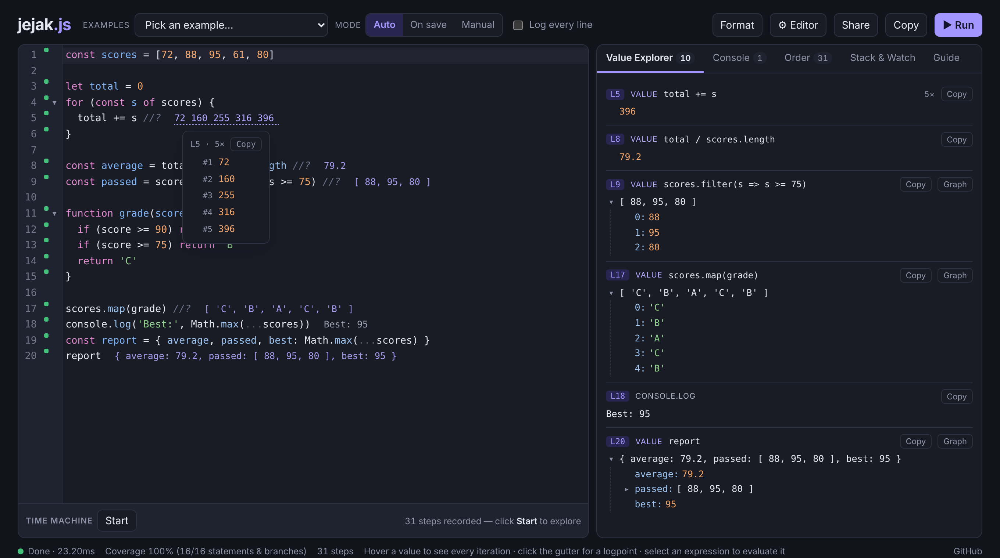

<div align="center">

# jejak.js

**See what your JavaScript is doing while you type.**

Inline values, live comments, code coverage, a Value Explorer and a Time Machine debugger. It runs fully in the browser: nothing to install, no server.

[](https://github.com/muhwal21/jejak-js/actions/workflows/ci.yml)
[](LICENSE)
[](CONTRIBUTING.md)

[**Live demo**](https://muhwal21.github.io/jejak-js/) · [Bahasa Indonesia](README.id.md) · [Report a bug](https://github.com/muhwal21/jejak-js/issues/new?template=bug_report.md) · [Request a feature](https://github.com/muhwal21/jejak-js/issues/new?template=feature_request.md)



</div>

*Jejak* is Indonesian for "trace" or "footprint".

## Why

When you are learning JavaScript (or debugging a tricky function) you keep adding `console.log`, re-running, and scrolling through output. jejak.js shows the result of every line right next to the code, every time you type, and lets you replay the execution step by step.

## Features

### See values

- **Inline values**: `console.log` output, an identifier alone on a line, and errors appear at the end of the line.
- **Loops**: every execution of a line is listed in order (`0 1 3 6 10`). Hover it to see each iteration.
- **Live comments**:

  | Comment | Shows |
  |---|---|
  | `expr //?` or `expr /*?*/` | the value |
  | `expr /*?.*/` | the value + execution time |
  | `expr /*?+*/` | the full object, 8 levels deep |
  | `expr //? $.length` | a transformed value (`$` is the result) |

- **Value Peek**: select any expression to evaluate it in its real context, or hover a variable.
- **Logpoints**: click the gutter (or press F9) to log a whole line. Select an expression and press Shift+F9 to pin it.

### Understand the flow

- **Coverage gutter**: green = ran, yellow = partly ran (the part that did not run is shaded), grey = never ran.
- **Errors**: underlined at the exact column; the call path that led there is marked pink.
- **Time Machine**: step into / over / out, step back, auto-play, jump to the cursor line, plus a timeline colored per function. Call stacks stay correct across `await`.
- **Execution order**: every executed line, in order, with who called whom.
- **Value Explorer**: an expandable tree of every value. Copy it as JSON or view it as a graph.

### A comfortable editor

- Autocomplete. After a dot, methods come from the value's real runtime type.
- Snippets with tab stops: `for`, `forof`, `if`, `try`, `arrow`, `class`, `map`, `reduce`, and more.
- Prettier formatting, plus a gentle auto-format that only fixes spacing. It never moves lines and never runs right after you delete something.
- Auto-closing brackets, comment toggle, multi-cursor, search, and code folding.
- Themes: light, dark, sepia, ocean and high contrast. UI in English and Bahasa Indonesia.
- Share links: the code is compressed into the URL, with no backend.

## Quick start

```bash
git clone https://github.com/muhwal21/jejak-js.git
cd jejak-js
npm install
npm run dev        # open http://localhost:5173
```

Requires Node.js 18 or newer.

| Script | What it does |
|---|---|
| `npm run dev` | Dev server with hot reload |
| `npm test` | Unit and runtime tests (Vitest) |
| `npm run typecheck` | TypeScript check |
| `npm run check` | Typecheck + tests (run before a pull request) |
| `npm run build` | Static site in `dist/` |
| `npm run build:single` | One self-contained HTML file in `dist-single/jejak.html` |

## Keyboard shortcuts

| Keys | Action |
|---|---|
| `Ctrl/⌘ Enter` | Run |
| `Ctrl/⌘ S` | Format (if enabled) and run |
| `Ctrl Space` | Show suggestions |
| `Tab` / `Shift Tab` | Next / previous snippet field |
| `Shift Alt F` | Format code |
| `Ctrl/⌘ /` | Toggle comment |
| `Ctrl/⌘ D` | Select next occurrence |
| `F9` / `Shift F9` | Toggle logpoint / pin selected expression |
| `Alt ← → ↑ ↓` | Time Machine: back / into / out / over (while it is open) |
| `Alt J` | Jump to the next execution of the cursor line |

## How it works

```
your code ──► instrument (acorn) ──► instrumented code + source map
                                          │
            runtime + code ──► Web Worker (sandboxed, can be stopped)
                                          │  batched messages
                                          ▼
              session ──► inline values · coverage · panels · Time Machine
```

The code is parsed with [acorn](https://github.com/acornjs/acorn) and small tracking calls are inserted around statements, functions and expressions, without changing what the program does. It then runs inside a Web Worker, so an infinite loop never freezes the page. See [docs/ARCHITECTURE.md](docs/ARCHITECTURE.md) for details.

```
src/
  core/        instrumenter, worker runtime, run model, coverage, share links (no DOM, unit-tested)
  ui/          editor, panels, Time Machine, Value Peek, autocomplete/snippets/format
  i18n.ts      English + Bahasa Indonesia strings
  examples.ts  built-in examples
test/          Vitest suites; harness.ts runs the real runtime in Node
scripts/       single-file build
```

## Deploying your own copy

The workflow in `.github/workflows/pages.yml` publishes every push to `main` to GitHub Pages. Turn it on in **Settings → Pages → Build and deployment → Source: GitHub Actions**.

## Limitations & roadmap

Code runs in a Web Worker, so for now there is no `document`, no npm imports and no TypeScript input. Ideas where help is welcome:

- [ ] DOM mode in a sandboxed iframe (`document`, canvas, `fetch`)
- [ ] npm imports through an ESM CDN
- [ ] TypeScript input
- [ ] CodeMirror 6 (type-aware autocomplete, better mobile editing)
- [ ] Edit-and-continue in the Time Machine
- [ ] Multiple files / tabs
- [ ] More than 5000 recorded steps

## Contributing

Contributions of any size are welcome: bug reports, examples, translations, features. Read [CONTRIBUTING.md](CONTRIBUTING.md) to get started. This project follows a [Code of Conduct](CODE_OF_CONDUCT.md).

## Acknowledgements

Inspired by [Quokka.js](https://quokkajs.com/). jejak.js is an independent project. It is not affiliated with Quokka or Wallaby.js and does not use their code.

## License

[MIT](LICENSE) © Awal ([@muhwal21](https://github.com/muhwal21))
